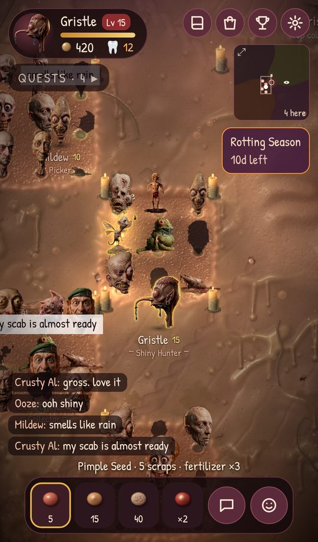
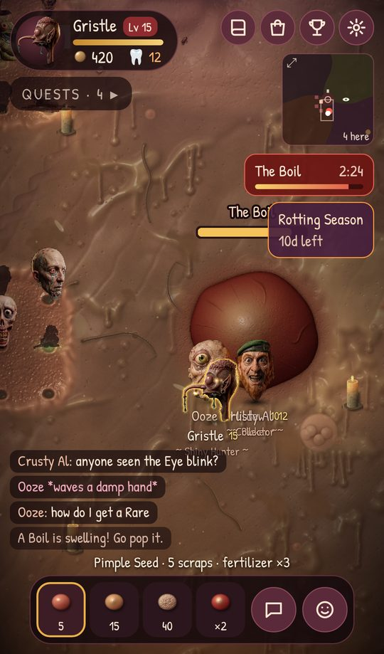
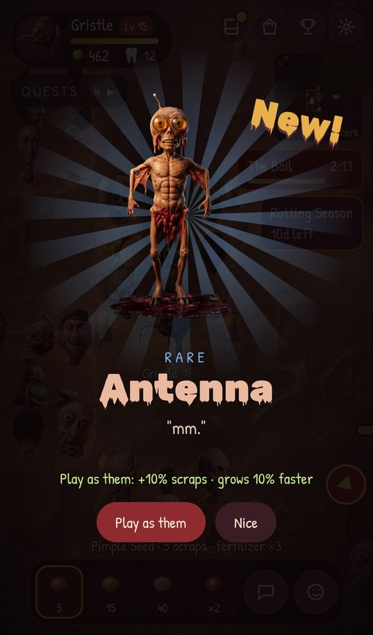
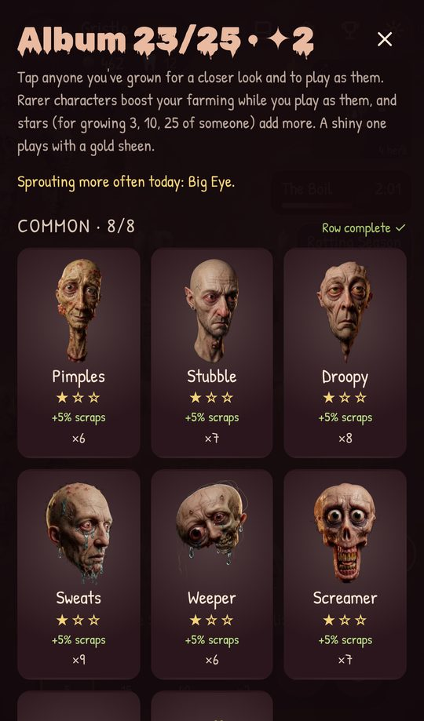
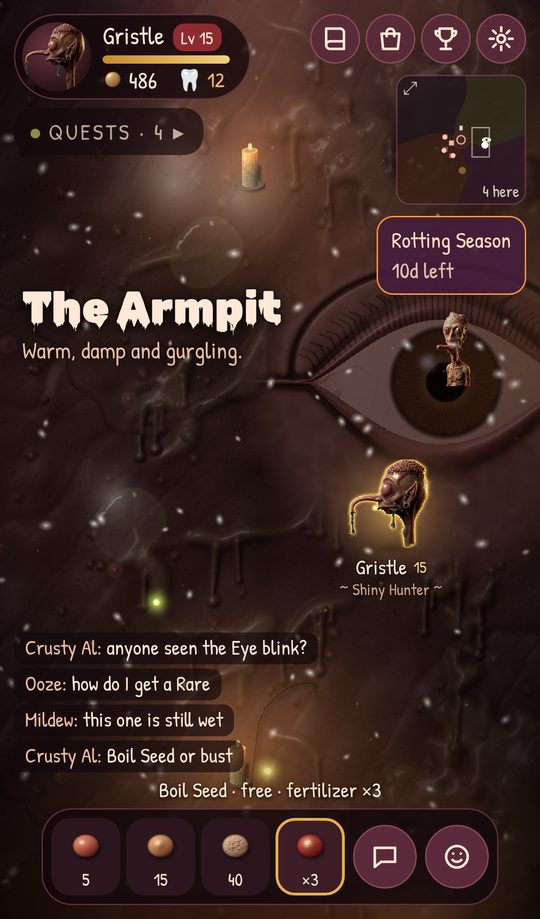

# Hairy Popsicles: The MMO

**Grow gross little characters out of the skin of the world, together.**

A spin-off of [Hairy Popsicles](https://github.com/dannyleb/hairy-popsicles-the-game):
the same flesh-toned, gross universe, now one shared world that everyone plays
in at once. Free, in your phone's browser. No install, no sign-up.

### [▶ Play now](https://dannyleb.github.io/hairy-popsicles-the-mmo/)

<table>
  <tr>
    <td align="center"><br><sub>Your plot and your neighbors'</sub></td>
    <td align="center"><br><sub>Everyone pops The Boil</sub></td>
    <td align="center"><br><sub>Something new came up</sub></td>
  </tr>
  <tr>
    <td align="center"><br><sub>Collect all 25</sub></td>
    <td align="center"><br><sub>Night falls; the Eye watches</sub></td>
    <td align="center"><br><sub>Four regions round the Navel</sub></td>
  </tr>
</table>

## What it is

The world is skin: a dark, wet, candlelit expanse of it, seen from above.
Everyone gets a plot, a raw sore with nine follicle holes. Plant a seed in a
hole and a character slowly rises out of it, a dark silhouette until it ripens
into one of 25 photoreal 3D creatures. Pull it out, keep it in your album, and
play as any one you've grown.

You're never alone in it. Everyone tends their patch in the same persistent
world, sees everyone else's, and gets more done together: squeeze a
neighbor's crop to ripen it sooner, crowd round a world event, chat, gift a
spare character to someone who hasn't found it.

## How to play

1. **Claim a plot.** New players get one on the spot, with a starter character.
2. **Plant.** Pick a seed and tap an open hole. Better seeds unlock as you level.
3. **Wait, or help it along.** Squeeze a neighbor's growing crop (it glows
   green) to ripen it 25% sooner and earn a few scraps; they can do the same for you.
4. **Harvest.** Tap a ripe crop to pull it out: it goes in your album, with
   scraps and XP. Something new gets a full-screen reveal.
5. **Play as them.** Wear any character you've grown. Rarer ones give
   bonuses: more scraps, faster crops, better shiny luck.

| Rarity | Characters | Grow time | Scraps |
|---|---|---|---|
| Common | 8 | 30 s | 7 |
| Uncommon | 7 | 1.5 min | 14 |
| Rare | 7 | 4 min | 35 |
| Legendary | 3 | 8 min | 90 |

Seeds cost scraps: **Pimple** (5) grows mostly Commons, **Pus** (15, level 3)
leans Uncommon, **Bone** (40, level 6) leans Rare, and the **Boil Seed**,
earned at events and in daily rewards, only grows Rares and Legendaries.

## What's in it

**Collecting**
- 25 characters in four rarities, an album with silhouettes for the ones you haven't found.
- Shinies: about 1 crop in 40 comes up shiny, with a gold outline everyone can see and triple scraps.
- Stars for growing 3, 10 and 25 copies; payouts for finishing a whole row of the album.
- A featured character each day that sprouts four times as often, and a stray to catch.

**Playing together**
- World events, one every few minutes, taking turns:

  | Event | What everyone does |
  |---|---|
  | **The Boil** | Tap it until it bursts. Big hitters win a Boil Seed. |
  | **The Scab** | Hold to peel its pieces. Wait for it to dry, or rip it early and bleed. |
  | **The Gash** | Pick the crumbs of crust out. The deep ones take two players. |
  | **The Tick** | It latches on and stops crops growing. Pry it off together. |
  | **Ingrown Hair** | Tug on the beat. A crowd in time pulls it out fast. |
  | **Blackheads** | Hold to squeeze them out, first come first served. |
  | **Navel Lint** | The Navel coughs up lint. Grab the glinting ball. |

- Pus Rain (grab the globs before they soak in), the Blood Moon (rarer crops
  for 90 seconds), and The Itch, a target the whole world hits together.
- Chat, emotes, pals, gifts, and invite links that pay both of you when your
  friend reaches level 3.

**Progress**
- Levels 1 to 15: more holes, better seeds, faster crops.
- Three quests at a time plus a bigger daily one; 21 titles to earn and wear.
- A shop (fertilizer, candles for your plot, name colors), a 7-day gift streak,
  and limited seasons like the Rotting Season, with its own currency (teeth).

**The world**
- Four regions around the Navel: the Scalp, the Armpit, Freckle Flats and Wart Hills.
- Landmarks: the Navel, a giant Eye that watches whoever's nearest, and a bone
  statue of whoever has collected the most.
- A day every 20 minutes, weather (dandruff, sweaty fog, an itchy wind),
  mites, fleas, a great pale worm, and a heartbeat that gets louder near the Navel.

**Made for phones**
- Opens from a link; add it to your home screen if you like.
- Pinch to zoom, picks up where you left off if the connection drops, and
  adapts its graphics to the device.
- Progress saves on your device, signed by the server so it can't be
  edited, and moves to a new phone with a save code.

Every rule and number is in **[docs/RULES.md](docs/RULES.md)**.

## Under the hood

A Phaser 3 + Vite client on GitHub Pages and a Colyseus server on Render (the
server decides everything), with saves in Neon Postgres. Characters are 3D
renders; the world art is generated procedurally by `tools/world.py`.

```
npm install
npm run dev:server   # the world, on ws://localhost:2567
npm run dev:client   # the game, on http://localhost:5173
npm test             # every server suite
```

Art pipeline, repo layout, testing, the admin page, security, deploy and
what's next: **[docs/DEVELOPMENT.md](docs/DEVELOPMENT.md)**.
