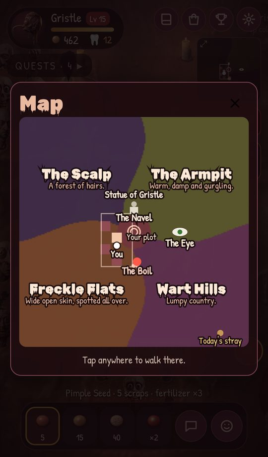
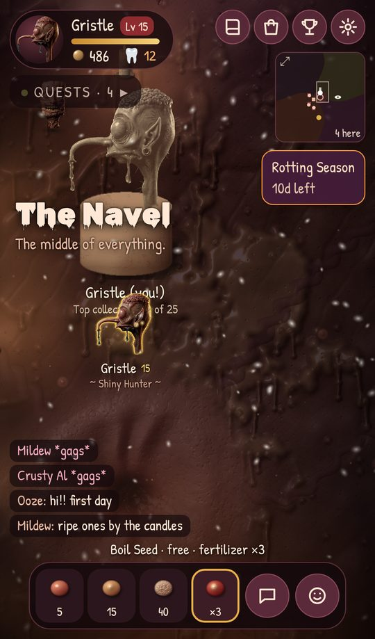

# How the game works

Every rule and number in Hairy Popsicles: The MMO, for players who want the
details and for whoever changes them. The short version is in the
[README](../README.md); how it's built is in [DEVELOPMENT.md](DEVELOPMENT.md).

## The idea

Not a true massive-scale MMO — that's not a realistic solo-dev scope. It's
the **.io-game pattern** (Agar.io / MooMoo.io): one shared real-time room,
dozens of concurrent players, instant play, no install, no login wall. Feels
like an MMO, ships like a small game.

## The core loop

Walk around a shared world → claim an empty plot → pick a
seed and plant it in one of your plot's holes → it grows into a random
character, a dark silhouette rising out of the hole until it ripens in full
color → pull it out into your album (plus scraps and XP) → play as any
character you've grown. Rarer characters take longer and pay more.

| Rarity | Characters | Grow time | Scraps | XP |
|---|---|---|---|---|
| Common | 8 | 30s | 7 | 10 |
| Uncommon | 7 | 1.5 min | 14 | 22 |
| Rare | 7 | 4 min | 35 | 50 |
| Legendary | 3 | 8 min | 90 | 120 |

| Seed | Cost | Unlocks | Common / Uncommon / Rare / Legendary |
|---|---|---|---|
| Pimple | 5 | level 1 | 55 / 28 / 13 / 4 % |
| Pus | 15 | level 3 | 20 / 50 / 24 / 6 % |
| Bone | 40 | level 6 | 0 / 35 / 50 / 15 % |
| Boil | drop only | from The Boil | 0 / 0 / 70 / 30 % |

Rarities live in
`packages/shared/src/characters.js`; seeds, levels and XP in
`packages/shared/src/progression.js`; quests in `quests.js`.

## The MMO layer

- **Levels (1-15).** XP from planting, harvesting, squeezing, quests and the
  boss. Your plot starts with 3 open holes; each level opens another
  (scabs cover the locked ones and pop off when they open), and better seeds
  unlock at levels 3 and 6. Past level 7, when every hole is open, each
  level makes your crops grow 3% faster (24% at level 15). Every 5th level
  is announced to the world.
- **Quests.** Three at a time, dealt from eleven kinds (harvest, harvest
  an Uncommon, harvest a Rare, plant, discover something new, squeeze a
  neighbor, chat, emote, help at world events, grab Pus Rain globs, change
  character). Finishing one pays scraps and XP and
  deals the next. Squeeze quests only show up while there's a neighbor to
  squeeze. On top of those, one bigger daily quest (pinned in gold) pays 60
  scraps, 120 XP and a Boil Seed. On a phone (700px wide or less) the quest
  list starts folded to one line ("Quests · 4", with a pulsing dot while The
  Itch is on); tapped open, it folds away again after 10 seconds.
- **Squeezing.** Tap a neighbor's growing crop: it ripens 25% sooner and
  you get 3 scraps. Up to 3 different people per crop. Squeezable crops
  glow green. This is the main reason to care that other people exist.
  When a player (level 2 or up) leaves, their plot stays in the world for
  24 hours if anything is growing in it (dimmed, marked "away"), so the world doesn't
  empty out and others can still squeeze it. It's theirs again when they
  come back, head start included: "Neighbors squeezed your crops 3 times
  while you were gone." The world room is never disposed, so this holds
  even when everyone has left.
- **World events.** One at a time, 3 minutes apart, taking turns: The Boil
  every third turn, and between them The Scab, The Gash, The Tick, Ingrown
  Hair, Blackheads and Navel Lint (`WORLD_EVENT.order` in
  `packages/shared/src/worldEvents.js`; each is its own module in
  `packages/server/src/game/`, run by `worldEvents.js`).
  Each shows in the event pill (tap it to walk over), the minimap and an
  edge-of-screen arrow, and everything done at one counts for the "Help at
  world events" quests. Rewards paid when one ends go to those still in the
  world then.
- **The Boil.** A giant boil swells up near someone. Everyone taps it; it
  gets redder and fatter until it bursts. Everyone who hit it gets scraps
  and XP; anyone with 3+ hits gets a Boil Seed (the top squeezer gets 2),
  which only grows Rare or Legendary. It sinks back after 2.5 minutes if
  nobody pops it.
- **The Scab.** A big crusty scab, wet at first and drying over 40 seconds.
  Hold a finger on it to peel a piece (a ring fills; keep holding for the
  next). Peeled dry, a piece pays 5 scraps; torn off early it pays 1 and
  bleeds three globs of blood anyone can grab (a scrap each; they don't
  count as Pus Rain globs), so waiting pays, unless someone else is racing
  you for the last piece. Whoever peels the last of its ten
  pieces finds a character underneath (Uncommon or better), and everyone
  who peeled gets a bit more. Scab Picker title for 30 pieces.
- **The Gash.** A wound tears open with crumbs of crust along it (10, plus
  4 a player, up to 26). Tap one to pick it out. With two or more players
  around, every fifth is deep: one player's tap loosens it for 2.5 seconds
  and a second player's tap gets it out, paying both. Picked clean, it zips
  shut; everyone who picked gets paid, the top picker (with 3 or more) a
  Boil Seed. Hands are counted by save, not connection. Wound Dresser title
  for 40 crumbs.
- **The Tick.** Latches on beside the plot with the most growing crops of
  anyone online, and the crops within reach stop growing while it feeds (red
  threads show which: every second it's on, their wait gets a second
  longer). Tap to pry: each pry counts once for every player who's pried in
  the last 2.5 seconds, so a crowd gets it off fast. Pried off by one player
  alone while someone else was nearby (800px) who could have helped, its
  head stays in: no Boil Seed or title count, and it's back in 90 seconds,
  once (then the turns carry on). If nobody gets it, it drops off full after
  2 minutes. Tick Twister title for 5.
- **Ingrown Hair.** Bulges up in the Scalp and throbs to a beat (a ring
  closes in on it each beat). Tap on the beat to tug the hair out a little;
  tap off it and it slips back. Everyone can tug once a beat, so a crowd in
  time pulls it out fast: out comes a hair as long as your arm. Everyone who
  tugged is paid by how many; the most (6+) gets a Boil Seed. The timing is
  judged on the player's screen, from when the finger lands (it's the one
  that sees the beat); the server takes one tug per player per beat, only for
  a beat that's now or just gone, and one slip per player per beat. Hair
  Puller title for 3 (each with at least 2 tugs).
- **Blackheads.** A patch of them (8, plus 3 a player, up to 20) in the
  Armpit. Hold a finger on one to squeeze it out; each comes out once, to
  whoever's first. 2 scraps each, and the gunk makes fertilizer: a dose for
  every 2 squeezed (at least one). Pore Squeezer title for 40.
- **Navel Lint.** The Navel gurgles, then coughs lint over its plaza three
  times, 6 seconds apart. Grab the balls (2 scraps each, like Pus Rain
  globs but not counted as them); the glinting one in each cough has
  something in it: 15 scraps, 2 doses of fertilizer, or a Boil Seed
  (announced). Lint Picker title for 30.
- **Pus Rain (event).** Every 5 minutes, for 45 seconds, globs of pus rain
  down around everyone online; tap one to run over and grab it (2 scraps, or
  10 for a rare gold one). Walking takes time (the same on every screen and
  on the server) and grabbing only counts once you're there, so whoever is
  nearest wins the race. The same rule applies to squeezing and to The Boil.
- **Blood Moon (event).** Every 9 minutes, for 90 seconds, the world goes
  red and every seed's Rare odds are x2.5 and Legendary x3.
- **The Itch (world goal).** Every 20 minutes or so the whole world itches:
  one shared target for everyone online ("Harvest 30 characters together"),
  sized by how many are on when it starts, with 12 minutes to hit it. It
  sits on top of the quest list with everyone's progress and your share.
  Everyone who helped gets 30 scraps, 60 XP and a Boil Seed; 5 scratches
  earn the Scratcher title.
- **Social.** Chat (log over the dock, bubbles over heads), six emotes, a
  "who's here" leaderboard ranked by album size, tap anyone to see their
  card (level, album, best character) and walk over, wave, or mute them.
  Rare and Legendary pulls, boss pops and milestones are announced to all.
  Give a spare copy of a character (you keep at least one) to anyone who's
  here, from their card: they get a "Gift!" reveal and everyone sees it
  (10 gifts earns the Generous title). Make anyone a pal ♥ from their card:
  pals get a heart by their name, and you're told when one arrives (or is
  already here when you do). Pals are kept on your device, keyed by a public
  id derived from the save (never the save id itself). Tap your own card,
  then Share my album, for a picture of who you play as, your level and
  title, and every character (silhouettes for the unfound) with the game's
  link: the phone's share sheet where it can take pictures, a download
  elsewhere.
- **Who's around.** On the title screen, and from the who's-here sheet in
  the world (Who's been by): everyone here now with how long since they last
  did anything ("active now", "idle 12 min", or "stepped away" while their
  phone's connection is dropped), then everyone who's been by in the last 3
  days, newest first ("2 h ago"), pals first in each. Players who leave before
  level 2 aren't listed (so a flood of throwaway players can't push anyone's
  friends off); up to 60 are. The server keeps the list in memory and refills
  it from the database after a restart (`packages/server/src/game/seen.js`,
  `GET /players`). Appear offline (Settings, per device) keeps a player off
  both lists and stops their invite link saying they're on; anyone in the
  world still sees them there. It's sent on joining and the moment it's
  switched, and goes in the save, so a restart doesn't put them back.
- **Invites.** "Invite a friend" (on the who's-here screen) shares the
  player's own link (`?with=<invite code>`: their public id, signed by the
  server, so nobody can make up a link for someone else). The friend's title screen says who
  invited them and whether they're on now; a brand-new player who joins by it
  starts right next to the inviter, and both become pals. When the friend
  reaches level 3 both get 50 scraps and a Boil Seed (the inviter at most 3
  times a day, paid on their return if they're away; the count and the
  friends already paid for are kept in the inviter's own save, so a restart or
  a replayed old save doesn't pay twice), and 3 friends earn the Ringleader
  title. The title screen also shows how many are playing now; that
  request goes out the moment the page opens, so a napping free server starts
  waking while the menu is read.
- **First minute.** A new player's title screen says what the game is in one
  line. In the world, a welcome card shows their starter character and the
  loop (grow, collect, play as them), then they're given a plot of their own
  on the spot. A bouncing arrow points at exactly what to tap next (a hole,
  then the ripe crop) while one coach line explains it, and their first crops
  ripen in 8 seconds whatever they turn out to be. Until they've opened the
  album (or played as their new character), the screen keeps to the
  essentials: no quests, event pills, world banners or boss pointer, and the
  daily-gift calendar waits to arrive as a reward at the end. Someone
  bringing an existing save to a new device skips all of it.
- **Hooks.** Full-screen reveal for every new character and every Rare+
  pull, a level-up splash listing what just unlocked, floating rewards,
  a guided first minute (above), an album
  with silhouettes of everyone you haven't found (tap one you have for a
  close-up with its stars, bonus and copies to the next star, and to play
  as it), a minimap, and an arrow to the world event when it's off screen.
  Tap the minimap for the big map: every region and landmark by name, the
  statue's subject, your plot, everyone here, the world event and today's
  stray, with labels that keep out of each other's way. Tap anywhere on it
  to walk there.
- **Phones.** If the app goes to the background and the socket drops, the
  server holds your player and plot for 90 seconds and the client
  reconnects into the same seat. Pinch (or the mouse wheel) zooms the
  world out to see more or in to see detail, and it's remembered; taps act
  when the finger lifts, so a second finger turns one into a pinch. One
  finger (or the mouse) dragged further than a tap drifts drags the ground
  to look around, with a little glide when it's let go (none in Calm mode):
  the camera stays there, with a Back to me button, until you walk
  somewhere, then glides back to you.
  Graphics adapt to the device: the canvas is capped at about 3.6M pixels
  (phones keep full density; big high-density laptop screens draw slightly
  softer) and frames are capped at 60 even on 120 Hz screens. Settings has
  "Always full sharpness", on by default; turned off, the game steps down by
  itself when frames come slowly (lower resolution, then no ambient glows),
  remembers it, and offers "Try full graphics again". A browser drawing
  without the graphics card is detected, drops to the lightest graphics
  either way, and is told how to fix it. Settings has sound, music, speech
  bubbles, vibration and Reduce motion (no screen shake or flashes, nothing
  pulsing forever), which starts on if the phone already asks for less
  motion.
- **Saves.** Your level, album, scraps, quests, streak and plot (with its
  crops) are saved on your device, signed by the server so they can't be
  edited. Come back and your plot reappears where it was (or as close as
  is free), and the crops kept growing while you were gone: "Welcome back,
  4 crops are ripe and waiting." Reloading or opening a second tab takes
  over your existing player rather than making a copy. To move to another
  phone, copy the save code from Settings → Move to another phone and paste
  it into Menu → Load a save on the new one.
- **Shinies and stars.** About 1 crop in 40 comes up shiny (1 in 20 under a
  Blood Moon): the same character with a gold outline that everyone can see
  once it's ripe, triple scraps, its own reveal and a world announcement.
  Play as a character you have a shiny of and you wear the gold, and leave
  a glinting trail as you walk (Rares leave a blue one, Legendaries gold). Growing 3,
  10 and 25 copies of a character earns it stars, shown in the album and
  next to your level while you play as it.
- **Album rows.** Grow every character of a rarity and that row of the
  album pays out once: Common 40 scraps, Uncommon 100 + a Boil Seed, Rare
  250 + 2, Legendary 600 + 3 (plus XP), with its own reveal and a world
  announcement. Album headings show each row's reward. Saves from before
  this get paid for rows they already finished.
- **The Rotting Season (limited event, Oct 20 to Nov 1 UTC).** While it's
  on, harvests drop teeth 🦷 (15% for a Common up to every Legendary or
  shiny). Teeth buy a Pumpkin name color sold only this season, and 31 earn
  the Trick or Treater title. A pill (top right) counts down the days and
  opens the shop's season corner; the world gets a faint orange-and-purple
  cast. Seasons are data (`packages/shared/src/season.js`): add another
  entry with dates, a token, a color and a title for the next one.
- **Featured character.** Each UTC day one character (picked from the date)
  sprouts 4x as often as the others of its rarity. The daily gift card and
  the album say who, or "a mystery Rare" if you've never grown it, and its
  album card gets a "Sprouting today" badge. A reason to look every day.
- **Strays.** Eight characters wander the world on their own (the server
  walks them; `packages/shared/src/strays.js`). One is always the day's
  featured character, glowing gold with a "Today's stray" label and a gold
  dot on the minimap: walk up and tap it to catch a copy for your album, once
  a day. Catching 7 earns the Dogcatcher title. The others hop and squeak
  when tapped, and one of them is swapped for someone new every 10 minutes.
- **Wear bonuses.** Who you play as matters: an Uncommon gives +10% scraps
  from harvests, a Rare also makes your crops grow 10% faster, a Legendary
  gives +20% scraps, 15% faster growth and double shiny luck, and every
  star adds another +5% scraps. Shown on album cards, on reveals, and when
  you switch.
- **Titles.** Twenty-one goals (harvest 25 and 150, squeeze 20, top The
  Boil 3 times, grab 50 globs, grow 3 shinies, chat 50 times, give 10 gifts,
  scratch The Itch 5 times, bring 3 friends, catch 7 strays, peel 30 pieces
  of scab, pick 40 crumbs, pry 5 ticks, pull 3 ingrown hairs, squeeze 40
  blackheads, grab 30 balls of lint, 31 teeth in the
  Rotting Season, a 7-day streak, 15 characters, all of them) each earn a title, announced to the
  world. Wear one under your name; tap your card (top left) to see them all
  with progress and switch.
- **Shop.** Somewhere to spend scraps besides seeds (the bag button, top
  right; also from your card and the season pill): fertilizer (3 doses for 30; each makes a crop grow twice as fast),
  candles for the corners of your plot (50 each, up to 4, seen by
  everyone), and name colors (150 each).
- **Daily gift.** The first visit each day (UTC) pays a reward on a 7-day
  track: scraps, with Boil Seeds on days 3, 6 and 7. Miss a day and the
  streak starts over. The title screen says what's waiting before you tap
  Continue: "Day 4 gift waiting", "2 crops ripe on your plot", today's
  featured character and any season, read from the save on the device.

## The world

Like the first game, the world is skin — here a dark, wet,
candlelit expanse of it seen from above, lit like the character renders.
Plots are raw sores with a 3x3 grid of follicle holes the characters grow out
of. Candles flicker at plot corners, pus-flies drift in loops, spores float
past, hairs, pimples, moles and slime puddles are scattered about, and the
camera follows you. It's alive between players too: the ground breathes,
hairs sway and get pushed aside as people walk through, everyone (strays
included) leaves a wet smear that dries off over half a minute, mites
trundle in loops and scatter from anyone near (tap one to squish it), fleas
sit and then spring away, and every 5 minutes a great pale worm crawls across
the world, in the same place on every screen. Players who are away nap beside
the plot the world is keeping for them, with a z drifting up now and then.
All of it is cheap (well under a millisecond a frame together), and trails
are off on the lite quality setting.

## Regions and landmarks

  
  

Defined in `packages/shared/src/regions.js`. The Navel is
the middle of the world, and each quarter around it is its own place, with
its own cast of color and props: the Scalp (a forest of long hairs), the
Armpit (sweat pools, steaming), Freckle Flats and Wart Hills. Borders wander
so they don't look ruled; your region's name comes up as you walk into it,
and the minimap is shaded by region. Purple veins run under the skin from the
Navel out to each region and to the Eye. Three landmarks stand on blocks of
plots nobody can claim (a plot saved where one now stands comes back next to
it): the Navel (tap it: it gurgles), a giant Eye that watches whoever's
nearest and blinks (poke it and it screws itself shut), and a bone statue of
whoever has collected the most characters, with their name and count. The
server picks the statue from everyone in the database seen in the last 90
days at startup, then hands it over whenever someone passes the record.
Still ground decor is only drawn near the view (in 320px cells), which keeps
the scene cheaper to draw than before all this was added.

## Day, night and weather

Worked out from the clock alone (`packages/shared/src/sky.js`), so every
screen agrees with no server traffic. A day lasts 20 minutes:
about 7 of daylight (a warm lift over the ground), 7 of night (a cool shade,
with candles and pus-flies glowing brighter), and a dusk and a dawn between.
A Blood Moon is always as dark as dusk. Every 6 minutes the weather may turn
(half the time it stays clear): dandruff drifting down, a sweaty fog, or an
itchy wind that streaks across the screen and swings the hairs round. It
fades in and out, and the chat log says when night falls, morning comes or
weather sets in. Reduce motion keeps the fog and slows the dandruff; the wind
streaks are left out.

## Ambience

Quiet procedural sounds (`packages/client/src/audio/ambience.js`) of
wherever you are, under the music and off with Sound: the world's
heartbeat, louder the nearer you are to the Navel; gurgles in the Armpit;
hairs rustling in the Scalp; little things chirping at night; gusts while the
wind blows. Characters on screen mutter their lines from the first
game's `src/roster.js` (characters without lines fall back to its grunts).

## Flow

An HTML loading screen (shows before the JavaScript arrives) → a
title menu over the drifting world (name, Play, How to play, Settings,
What's new, Credits, Load a save) → connecting (with a "waking the server" message after a few
seconds, and a retry) → the world.

## Phone niceties

A short buzz with harvests, hits, squeezes, grabs and
level-ups (Android; iPhones don't allow it), and from the second visit, a
one-time hint to add the game to the home screen (Chrome's install prompt,
or the Share → Add to Home Screen steps on iPhone).

## Sound

The first game's two music tracks, alternating, plus procedural
Web Audio effects (no files) for steps, planting, harvests by rarity,
squeezing, boss hits and bursts, quests, level-ups and chat. Sound, music,
vibration and speech bubbles can each be turned off in Settings (remembered
per device).
